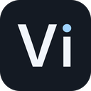
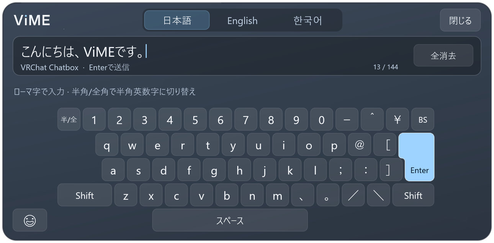
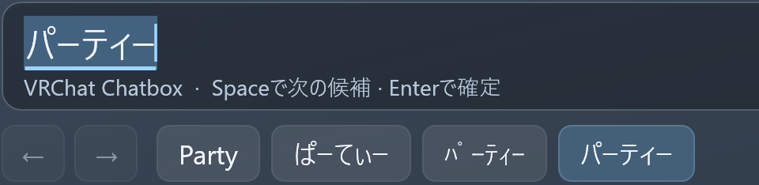

#  ViME

ViME is an open-source IME keyboard for SteamVR on Windows. Type in Japanese, English, or Korean with your VR controllers and send text to the VRChat Chatbox or a compatible SteamVR app.

**[Download for Windows (GitHub Releases)](https://github.com/Harukoto-Project/vime/releases)** · [日本語](README.md) · English · [한국어](README.ko.md)



## Install

1. Download `ViME-<version>-windows-x64.zip` from [Releases](https://github.com/Harukoto-Project/vime/releases).
2. Extract the ZIP and run `vime.exe`. The release build runs on Windows x64 and requires no Rust installation.
3. Start SteamVR for VR use. If ViME is already running, select **Connect to SteamVR** in the Windows app. You can try the keyboard in the Windows preview before connecting.

If a release ZIP is unavailable, [run ViME from source](#run-from-source).

## Send a message to VRChat

1. In the VRChat Action Menu, turn on **OSC → Enabled**. Keep ViME’s destination set to **VRChat OSC**. If you changed VRChat’s receiving port, set ViME to the same port. The default is `9000`. [Official VRChat OSC guide](https://docs.vrchat.com/docs/osc-overview)
2. Click the **right thumbstick** (**right trackpad** on Vive Wand) or press **Ctrl+Shift+F8** on your PC to open the keyboard. Point either controller at a key and press the trigger to type.
3. Type a message and press **Enter** on the VR keyboard to send it to the Chatbox. While converting text, the first **Enter** confirms your text. Press it again to send.

Keep ViME running during your VR session. The **ViME** tab in the SteamVR dashboard also gives you access to the keyboard, output settings, and controller bindings.

In the Windows app’s **Settings**, you can change the OSC notification sound, toggle shortcut, and VR keyboard width. Settings are stored at `%LOCALAPPDATA%\ViME\settings.json`.

## Switch languages and convert text

- **Japanese** uses a JIS layout with romaji input. Use the space bar to open conversion candidates for kanji and katakana. Digits and Latin letters stay half-width, while punctuation is full-width by default, including Japanese `、` and `。`. Pick half-width punctuation or katakana from the candidates. The **半/全** key switches to direct half-width input.
- **English** uses QWERTY. **Korean** uses Dubeolsik, with **한/영** to switch to direct Latin input.
- Open the emoji, kaomoji, and symbol palette with **😃** at the bottom left. In English mode, you can also look up emoji with shortcodes such as `:cat:`.



## Use ViME with another SteamVR app

In ViME’s **Settings**, choose **SteamVR app input** as the destination and save. Open a text field in the target app, bring that app to the foreground in Windows, and press **Enter** on the VR keyboard. The target app must accept Windows text input events.

## Troubleshooting

- **The controller shortcut does not open the keyboard.** Try **Ctrl+Shift+F8** first. Open the SteamVR binding editor from ViME to change the controller shortcut or restore the default binding.
- **Messages do not appear in the Chatbox.** Check that OSC is enabled in VRChat, the destination is **VRChat OSC**, and the receiving port matches.
- **ViME cannot find SteamVR.** Start SteamVR and reconnect. For a custom installation, set the `STEAMVR_PATH` environment variable to the SteamVR installation directory.

ViME is a prototype. Headset rendering, per-controller bindings, and VRChat reception still need testing on actual hardware. Include your ViME version, hardware models, and steps to reproduce when reporting a problem. [GitHub Issues](https://github.com/Harukoto-Project/vime/issues)

## Run from source

You need Windows x64, Rust 1.95 or later, and MSVC C++ Build Tools. Run this from the repository root.

```powershell
cargo run --release --locked
```

The executable is built at `target/release/vime.exe`. See the [contribution guide](CONTRIBUTING.md) for development and pull requests.

## License

[Apache License 2.0](LICENSE)
