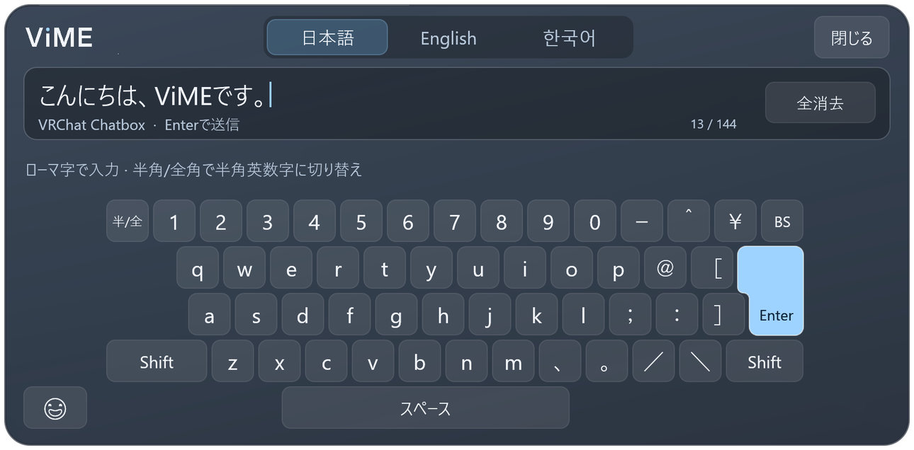

# ViME

[English](README.md) · 日本語 · [한국어](README.ko.md)

ViMEは、VR内で日本語・英語・韓国語を入力できる、Windows向けのオープンソースIMEキーボードです。コントローラーでキーを押し、入力した文章をVRChatのChatboxや対応するSteamVRアプリに送れます。

**[Windows版のダウンロード（GitHub Releases）](https://github.com/Harukoto-Project/vime/releases)**



## インストール

1. [Releases](https://github.com/Harukoto-Project/vime/releases) から `ViME-<バージョン>-windows-x64.zip` をダウンロードします。
2. ZIPを展開し、`vime.exe` を起動します。配布版はWindows x64向けで、Rustのインストールは不要です。
3. VRで使うときはSteamVRを起動します。ViMEが先に起動していた場合は、Windows画面の **SteamVR に接続** を押してください。Windows画面のキーボードプレビューは、SteamVRに接続する前でも試せます。

配布ZIPが見つからない場合は、[ソースから起動する](#ソースから起動する)手順を使ってください。

## VRChatに送る

1. VRChatのAction Menuで **OSC → Enabled** をオンにします。ViMEの送信先は既定の **VRChat OSC** を使用します。VRChatの受信ポートを変更している場合は、ViMEでも同じポートを設定してください。既定は `9000` です。 [VRChatのOSC公式ガイド](https://docs.vrchat.com/docs/osc-overview)
2. **右スティック押し込み**（Vive Wandは**右トラックパッド押し込み**）か、PCの **Ctrl+Shift+F8** でキーボードを開きます。左右どちらのコントローラーでも、キーを指してトリガーを押すと入力できます。
3. 文章を入力し、キーボードの **Enter** でChatboxに送ります。変換中は1回目の **Enter** で文字を確定し、もう一度押すと送信します。

VRで使っている間はViMEを起動したままにしてください。SteamVRダッシュボードの **ViME** タブからも、キーボード、送信設定、コントローラーの割り当てを開けます。

Windows画面の **設定** では、OSCの通知音、開閉ショートカット、VRキーボードの幅を変更できます。設定は `%LOCALAPPDATA%\ViME\settings.json` に保存されます。

## 言語の切り替えと変換

- **日本語**はJIS配列でローマ字入力できます。スペースキーの **変換** で漢字やカタカナの候補が出ます。数字と英字は半角のまま、記号は全角で、`,` は `、`、`.` は `。` になります。記号とカタカナの半角表記も変換候補から選べます。**半/全** は半角の直接入力への切り替えです。
- **English** はQWERTY、**한국어** は두벌식（2ボル式）です。韓国語の **한/영** で英数字の直接入力に切り替えられます。
- **左下の 😃** で絵文字・顔文字・記号の一覧を開きます。英語入力では `:cat:` のような短縮名からも絵文字を選べます。


## ほかのSteamVRアプリで使う

ViMEの **設定** で、送信先を **SteamVR アプリ入力** に変更して保存します。対象のVRアプリで文字入力欄を開き、そのアプリをWindowsの前面にした状態で、VR側のキーボードから **Enter** を押します。対象アプリがWindowsの文字入力イベントを受け付ける必要があります。

## うまく動かないとき

- **コントローラーで開かない**場合は、まず **Ctrl+Shift+F8** で開けるか確認してください。コントローラーの割り当てはViMEからSteamVRの編集画面を開いて変更できます。カスタム割り当てを使っている場合は、SteamVRでViMEの既定の割り当てに戻せます。
- **Chatboxに届かない**場合は、VRChatのOSCが有効で、ViMEの送信先が **VRChat OSC** になっているか、受信ポートと一致しているかを確認してください。
- **SteamVRが見つからない**場合は、SteamVRを起動してから再接続してください。別の場所にインストールしている場合は、環境変数 `STEAMVR_PATH` にインストールフォルダを指定できます。

ViMEは試作版です。ヘッドセットやコントローラーごとの動作、VRChatでの受信は実機検証が必要です。不具合の報告には、ViMEのバージョン、機器名、再現手順を添えてください。 [GitHub Issues](https://github.com/Harukoto-Project/vime/issues)

## ソースから起動する

Windows x64、Rust 1.95以降、MSVC C++ Build Toolsが必要です。リポジトリのルートで実行します。

```powershell
cargo run --release --locked
```

実行ファイルは `target/release/vime.exe` に生成されます。開発・変更の提出については [コントリビュートガイド](CONTRIBUTING.md) を参照してください。

## ライセンス

[Apache License 2.0](LICENSE)
