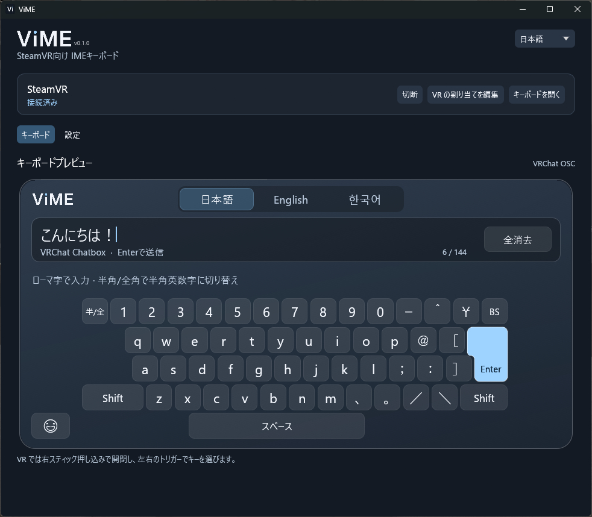
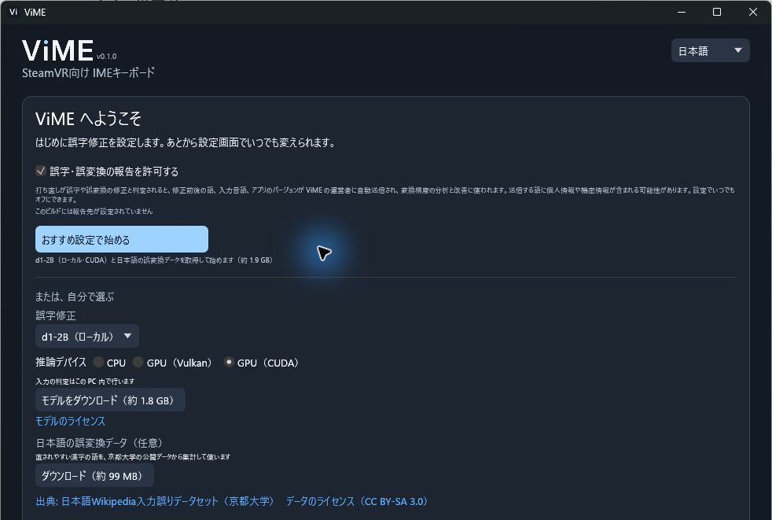
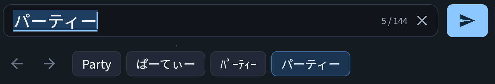
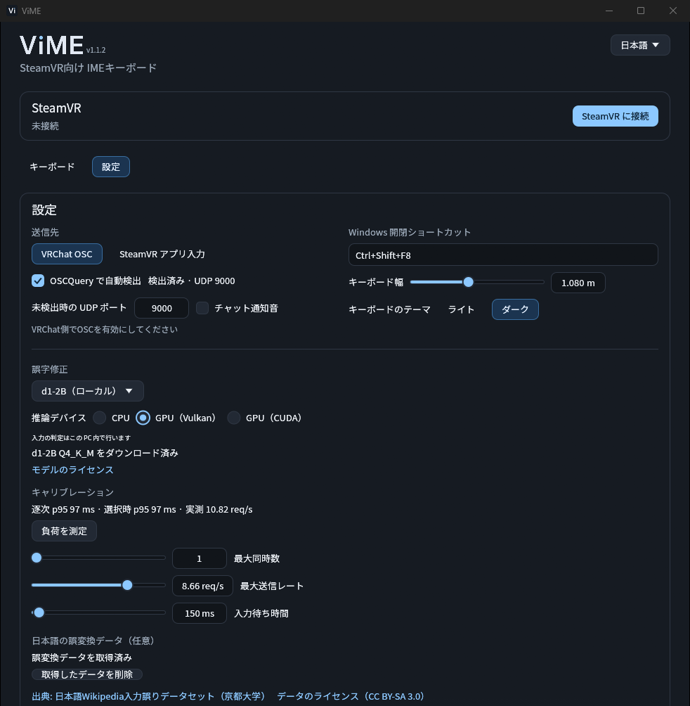

# ViME

ViMEは、VR内で日本語・英語・韓国語を入力できる、Windows向けのオープンソースIMEキーボードです。コントローラーでキーを押し、入力した文章をVRChatのChatboxや対応するSteamVRアプリに送れます。

**[Windows版のダウンロード（GitHub Releases）](https://github.com/Harukoto-Project/vime/releases)**

[インストール](#インストール) · [自動起動とトレイ](#steamvrでの自動起動とwindowsの通知領域) · [VRChatで使う](#vrchatに送る) · [入力と変換](#言語の切り替えと変換) · [誤字修正](#誤字修正) · [ソースから起動](#ソースから起動する)

[English](README.md) · [日本語](README.ja.md) · [한국어](README.ko.md)


<details>
<summary>Windows 版のキーボードプレビュー</summary>



</details>

## インストール

1. [Releases](https://github.com/Harukoto-Project/vime/releases) から `ViME-<バージョン>-windows-x64.msi` をダウンロードします。
2. MSIを実行し、インストール後にWindowsのスタートメニューから **ViME** を起動します。配布版はWindows x64向けで、Rustのインストールは不要です。
3. 初回画面で誤字修正を設定します。**おすすめ設定で始める**を選ぶと、ローカル d1-2B と CUDA 用の実行環境、日本語の誤変換データのダウンロードが始まります。初回は合計約 1.9 GB です。まずキーボードを試す場合は **あとで設定する**を選べます。
4. VRで使うときはSteamVRを起動します。ViMEが先に起動していた場合は、Windows画面の **SteamVR に接続** を押してください。Windows画面のキーボードプレビューは、SteamVRに接続する前でも試せます。



MSIが見つからない場合は、[ソースから起動する](#ソースから起動する)手順を使ってください。

**v1.0.0・v1.1.0からの移行**。旧版で更新の準備ができたら、**設定 → 再起動して更新**を選びます。MSIが起動し、インストール完了後にViMEが開きます。通知領域から終了した場合は、次回起動時にMSIが開きます。移行に成功すると、旧フォルダーの `vime.exe` はMSI版を開く `ViME.lnk` に置き換わります。設定やダウンロード済みデータはそのまま使えます。

配布版は起動時に GitHub Releases の更新を確認します。更新の準備ができたら、通知領域の **ViME を終了**でアプリを終了すると適用されます。すぐに適用するには **設定 → 再起動して更新**を選びます。

## SteamVRでの自動起動とWindowsの通知領域

1. ViME を手動で起動し、SteamVR に一度接続してオーバーレイを登録します。
2. SteamVR の **設定 → スタートアップ／シャットダウン → スタートアップオーバーレイアプリを選択**で **ViME** をオンにします。SteamVR から自動起動した ViME は、ウィンドウを表示せずに Windows の通知領域（システムトレイ）に常駐します。

ViME のウィンドウを閉じても通知領域に常駐し、VR キーボードを引き続き使えます。Windows の画面を開くには、アイコンをクリックするか、右クリックして **ウィンドウを開く**を選びます。アプリを終了するには、アイコンを右クリックして **ViME を終了**を選びます。

## VRChatに送る

1. VRChatのAction Menuで **OSC → Enabled** をオンにします。ViMEの送信先は既定の **VRChat OSC** を使用します。
2. **右スティック押し込み**（Vive Wandは**右トラックパッド押し込み**）か、PCの **Ctrl+Shift+F8** でキーボードを開きます。左右どちらのコントローラーでも、キーを指してトリガーを押すと入力できます。
3. 文章を入力し、キーボードの **Enter** でChatboxに送ります。変換中は1回目の **Enter** で文字を確定し、もう一度押すと送信します。

左右のポインターは別々に描画され、SteamVR のフレームに合わせて更新されます。キーボードの表示が変わらない間も、コントローラーの動きに追従します。

**OSCQuery で自動検出**を使うと、同じ PC で動く VRChat の受信用 UDP ポートを検出できます。新規設定では既定でオンです。v1.0.0 で保存した設定を引き継ぐ場合は、**設定**で自動検出をオンにして保存してください。自動検出がオフ、またはポートを検出できない間は、設定済みの UDP ポート（既定は `9000`）を使います。 [VRChatのOSCQuery公式ガイド](https://docs.vrchat.com/docs/oscquery)

SteamVRダッシュボードの **ViME** タブからも、キーボード、送信設定、コントローラーの割り当てを開けます。

Windows画面の **設定** では、OSCの通知音、開閉ショートカット、VRキーボードの幅を変更できます。設定は `%LOCALAPPDATA%\ViME\settings.json` に保存されます。

## 言語の切り替えと変換

- **日本語**はJIS配列でローマ字入力できます。スペースキーの **変換** で漢字やカタカナの候補が出ます。数字と英字は半角のまま、記号は全角で、`,` は `、`、`.` は `。` になります。記号とカタカナの半角表記も変換候補から選べます。**半/全** は半角の直接入力への切り替えです。
- **English** はQWERTY、**한국어** は두벌식（2ボル式）です。韓国語の **한/영** で英数字の直接入力に切り替えられます。
- **左下の 😃** で絵文字・顔文字・記号の一覧を開きます。英語入力では `:cat:` のような短縮名からも絵文字を選べます。
- 日本語の未確定入力では、**Backspace** を押すと表示上の1文字を削除します。たとえば `きゃ` は `き` になります。**Backspace** と **Space** は押し続けると連続入力できます。キーを押すと打鍵音が鳴ります。



## 誤字修正

誤字修正を有効にすると、辞書の読みに近い日本語の入力に修正候補が出ます。候補欄の **✓** 付きの候補を選ぶと入力が置き換わります。日本語の誤変換データを追加すると、漢字の変換ミスも候補にできます。

### d1-2B（ローカル）の推論デバイスを選ぶ

PCの構成によっては **GPU（Vulkan）** が **GPU（CUDA）** より速く動きます。両方使える場合は、次の手順で比べてください。

1. Windows 版で **設定 → 誤字修正 → d1-2B（ローカル）** を選びます。**推論デバイス**で **GPU（CUDA）** を選び、必要ならモデルや推論エンジンをダウンロードします。
2. **キャリブレーション**の **負荷を測定**を押します。完了後に **最大送信レート**（req/s）を確認します。
3. **GPU（Vulkan）** に切り替え、必要なダウンロードを済ませてから、同じ条件で再度測定します。**最大送信レート**が高い方を選び、**設定を保存**を押します。GPU 推論が使えない場合は **CPU** を選べます。

以前にレートを手動で変更した場合は、各デバイスで **自動設定に戻す** を押してから値を比べてください。

比較する値は、**負荷を測定** ボタンの下にある **最大送信レート** です。ボタン上の **実測** は、測定中に観測した処理件数を req/s で表示します。



### API と報告の設定

ローカル d1-2B はこの PC 上で判定します。**d1-2B（API）**、**TypeSafe Jev**、**System One 互換**を選ぶ場合、判定対象の語と前後の一部が設定先へ送信されます。

**誤字・誤変換の報告を許可する**は既定でオンです。報告先を設定したビルドでは、誤字修正が有効で、打ち直しが修正と判定されると、修正前後の語、入力言語、ViME のバージョンを運営者に送ります。初回画面または **設定**でオフにできます。[報告 API の仕様](CONTRIBUTING.md#誤字誤変換の報告-api)

## ほかのSteamVRアプリで使う

ViMEの **設定** で、送信先を **SteamVR アプリ入力** に変更して保存します。対象のVRアプリで文字入力欄を開き、そのアプリをWindowsの前面にした状態で、VR側のキーボードから **Enter** を押します。対象アプリがWindowsの文字入力イベントを受け付ける必要があります。

## うまく動かないとき

- **コントローラーで開かない**場合は、まず **Ctrl+Shift+F8** で開けるか確認してください。コントローラーの割り当てはViMEからSteamVRの編集画面を開いて変更できます。カスタム割り当てを使っている場合は、SteamVRでViMEの既定の割り当てに戻せます。
- **Chatboxに届かない**場合は、VRChatのOSCが有効で、ViMEの送信先が **VRChat OSC** になっているか確認してください。検出済みのポートが表示されない場合は、設定したUDPポートがVRChatの受信ポートと一致しているか確認してください。
- **SteamVRが見つからない**場合は、SteamVRを起動してから再接続してください。別の場所にインストールしている場合は、環境変数 `STEAMVR_PATH` にインストールフォルダを指定できます。

ViMEは試作版です。ヘッドセットやコントローラーごとの動作、VRChatでの受信は実機検証が必要です。不具合の報告には、ViMEのバージョン、機器名、再現手順を添えてください。 [GitHub Issues](https://github.com/Harukoto-Project/vime/issues)

## ソースから起動する

Windows x64、Rust 1.95以降、MSVC C++ Build Toolsが必要です。リポジトリのルートで実行します。

```powershell
cargo run --release --locked
```

実行ファイルは `target/release/vime.exe` に生成されます。開発・変更の提出については [コントリビュートガイド](CONTRIBUTING.md) を参照してください。

## ライセンス

[Apache License 2.0](LICENSE)

### 要求したときだけ取得するデータ

ViME には日本語Wikipedia入力誤りデータセットの複製は含まれません。設定の「日本語の誤変換データ」で **ダウンロード** を押すと、ViME が京都大学から [JWTD v2](https://nlp.ist.i.kyoto-u.ac.jp/EN/index.php?JWTD)（京都大学 言語メディア研究室、[CC BY-SA 3.0](https://creativecommons.org/licenses/by-sa/3.0/deed.ja)）を直接取得し、編集者が直した漢字の語を集計します。残るのはその語の表だけで、`%LOCALAPPDATA%\ViME\misconversions.tsv` に保存されます。この表は共有されず、CC BY-SA 3.0 のままです。田中佑、村脇有吾、河原大輔、黒橋禎夫。言語処理学会第27回年次大会、2021年。[JWTD v2 の論文](https://www.anlp.jp/proceedings/annual_meeting/2021/pdf_dir/E8-3.pdf)

打鍵音は unicaegames の [Keyboard Soundpack #1](https://opengameart.org/node/122745)（[CC0 1.0](https://creativecommons.org/publicdomain/zero/1.0/)）を使用しています。ローカル推論には [llama.cpp](https://github.com/ggml-org/llama.cpp) と [Liquid AI の d1-2B Q4_K_M](https://huggingface.co/LiquidAI/d1-2B-GGUF) を使用します。
