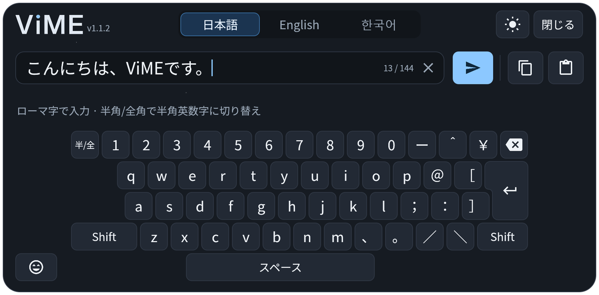
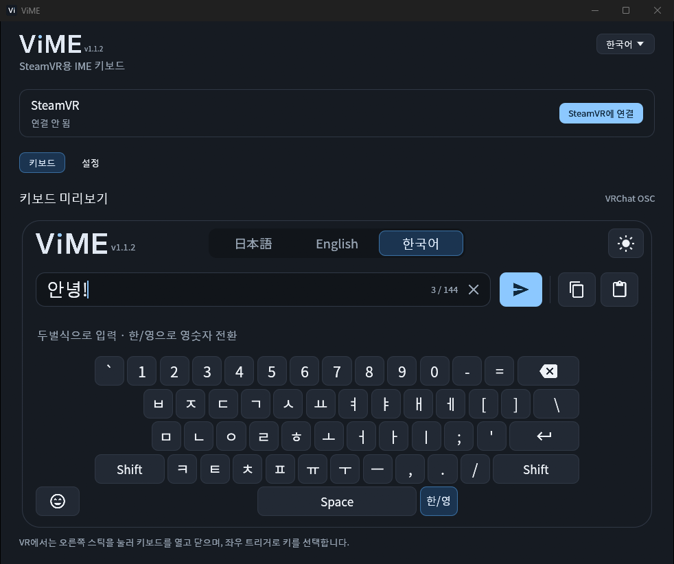
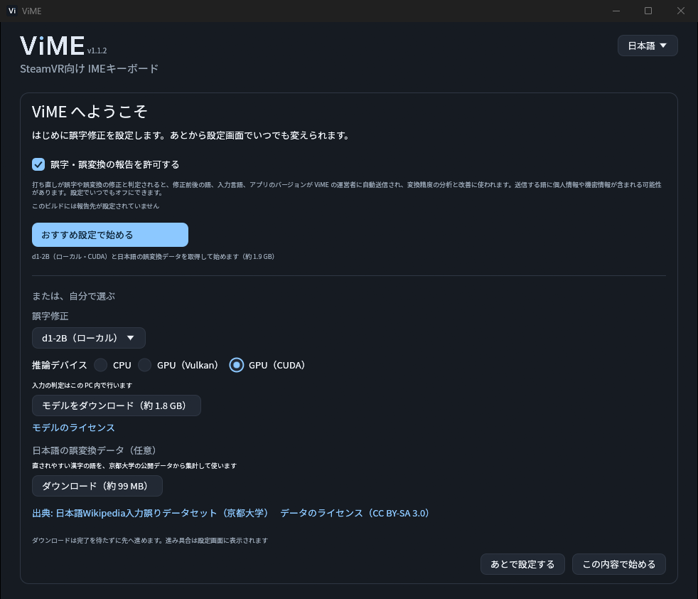
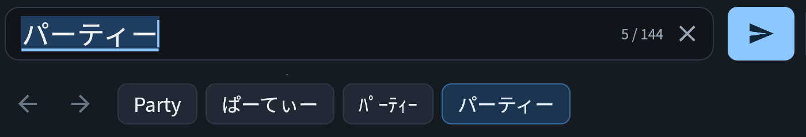
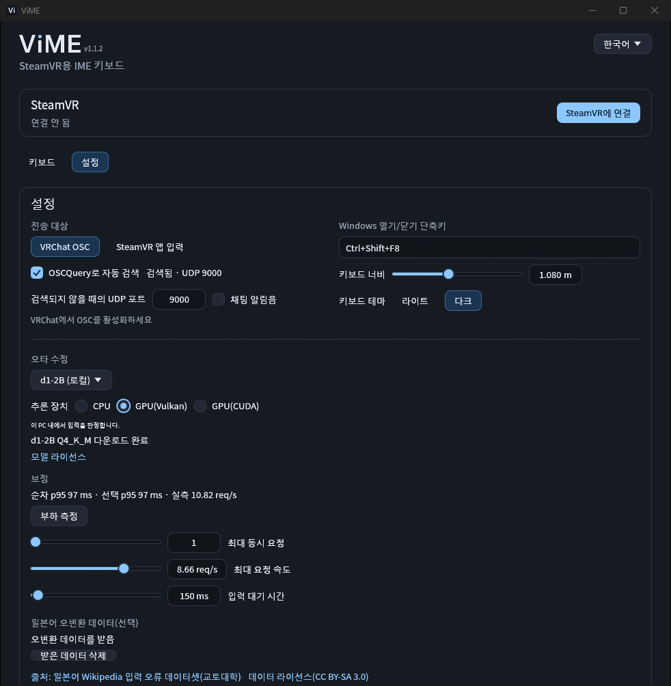

# ViME

ViME는 Windows에서 실행되는 SteamVR용 오픈 소스 IME 키보드입니다. VR 컨트롤러로 일본어, 영어, 한국어를 입력하고 VRChat Chatbox나 호환되는 SteamVR 앱으로 보낼 수 있습니다.

**[Windows 버전 다운로드(GitHub Releases)](https://github.com/Harukoto-Project/vime/releases)**

[설치](#설치) · [자동 실행 및 트레이](#steamvr-자동-실행과-windows-시스템-트레이) · [VRChat에서 사용](#vrchat에-메시지-보내기) · [입력 및 변환](#언어-전환-및-문자-변환) · [오타 수정](#오타-수정) · [소스에서 실행](#소스에서-실행)

[English](README.md) · [日本語](README.ja.md) · [한국어](README.ko.md)



<details>
<summary>Windows 키보드 미리보기</summary>



</details>

## 설치

1. [Releases](https://github.com/Harukoto-Project/vime/releases)에서 `ViME-<버전>-windows-x64.msi`를 다운로드합니다.
2. MSI를 실행한 뒤 Windows 시작 메뉴에서 **ViME**를 엽니다. 배포 버전은 Windows x64용이며 Rust를 설치할 필요가 없습니다.
3. 처음 실행하면 오타 수정 설정을 선택합니다. **추천 설정으로 시작**을 선택하면 로컬 d1-2B와 CUDA 실행 환경, 일본어 오변환 데이터를 다운로드합니다. 처음 설치할 때는 약 1.9 GB를 받습니다. 키보드부터 사용하려면 **나중에 설정**을 선택하세요.
4. VR에서 사용하려면 SteamVR을 실행합니다. ViME를 먼저 실행했다면 Windows 앱에서 **SteamVR에 연결**을 누르세요. 연결하기 전에도 Windows 앱의 키보드 미리보기에서 입력을 시험해 볼 수 있습니다.



MSI가 없다면 [소스에서 실행](#소스에서-실행)할 수 있습니다.

**v1.0.0 또는 v1.1.0에서 업그레이드하는 경우** 업데이트가 준비되면 기존 앱에서 **설정 → 다시 시작하여 업데이트**를 선택합니다. MSI 설치가 끝나면 ViME가 다시 열립니다. 시스템 트레이에서 종료하면 다음 실행 시 MSI가 열립니다. 이전 폴더의 `vime.exe`는 설치된 ViME를 여는 `ViME.lnk`로 바뀝니다. 설정과 다운로드한 데이터는 그대로 사용할 수 있습니다.

배포 버전은 시작할 때 GitHub Releases에서 업데이트를 확인합니다. 업데이트가 준비되면 시스템 트레이에서 **ViME 종료**를 선택할 때 적용됩니다. 바로 적용하려면 **설정 → 다시 시작하여 업데이트**를 선택하세요.

## SteamVR 자동 실행과 Windows 시스템 트레이

1. ViME를 직접 실행하고 SteamVR에 한 번 연결해 오버레이를 등록합니다.
2. SteamVR에서 **설정 → 시작/종료 → 시작 오버레이 앱 선택**으로 이동해 **ViME**를 켭니다. SteamVR이 ViME를 자동으로 실행하면 창이 숨겨진 상태로 Windows 시스템 트레이에서 실행됩니다.

ViME 창을 닫아도 앱이 시스템 트레이에서 계속 실행되므로 VR 키보드를 계속 사용할 수 있습니다. Windows 창을 다시 열려면 트레이 아이콘을 클릭하거나 마우스 오른쪽 버튼으로 클릭한 뒤 **창 열기**를 선택합니다. 앱을 종료하려면 아이콘을 마우스 오른쪽 버튼으로 클릭하고 **ViME 종료**를 선택합니다. ViME가 이미 실행 중일 때 시작 메뉴에서 다시 실행하면 두 번째 창을 열지 않고 실행 중인 창을 앞으로 가져옵니다.

## VRChat에 메시지 보내기

1. VRChat의 Action Menu에서 **OSC → Enabled**를 켭니다. ViME의 전송 대상은 기본값인 **VRChat OSC**를 사용합니다.
2. **오른쪽 스틱**(Vive Wand는 **오른쪽 트랙패드**)을 누르거나 PC에서 **Ctrl+Shift+F8**을 눌러 키보드를 엽니다. 어느 쪽 컨트롤러로든 키를 가리키고 트리거를 누르면 입력됩니다.
3. 메시지를 입력한 뒤 VR 키보드의 **Enter** 또는 전송 버튼을 눌러 Chatbox로 보냅니다. 변환 중에는 첫 번째 **Enter**로 글자를 확정하고, 한 번 더 누르면 전송합니다.

입력란 옆의 **×**는 입력한 글자를 지웁니다. 복사와 붙여넣기 버튼은 Windows 클립보드를 사용합니다. 붙여넣은 결과가 VRChat의 제한인 144자를 넘으면 붙여넣지 않습니다. 키보드 위쪽의 해와 달 버튼으로 다크 테마와 라이트 테마를 전환할 수 있습니다.

왼쪽과 오른쪽 포인터는 각각 그려지며 SteamVR 프레임에 맞춰 갱신됩니다. 키보드 화면에 변화가 없어도 컨트롤러의 움직임을 따라갑니다. 키보드는 더 높은 픽셀 밀도로 그려져 글자가 또렷하게 보입니다.

**OSCQuery로 자동 검색**은 같은 PC에서 실행 중인 VRChat의 수신 UDP 포트를 찾습니다. 새 설정에서는 기본적으로 켜져 있습니다. v1.0.0에서 저장한 설정을 이어서 사용한다면 **설정**에서 자동 검색을 켜고 저장하세요. 자동 검색이 꺼져 있거나 포트를 찾지 못하면 설정된 UDP 포트(기본값 `9000`)를 사용합니다. [VRChat OSCQuery 공식 가이드](https://docs.vrchat.com/docs/oscquery)

SteamVR 대시보드의 **ViME** 탭에서도 키보드와 전송 설정을 열고 컨트롤러 할당을 편집할 수 있습니다.

Windows 앱의 **설정**에서 OSC 알림음, 키보드 열기 및 닫기 단축키, VR 키보드 너비, 키보드 테마(**다크** 또는 **라이트**)를 바꿀 수 있습니다. 테마는 VR 키보드와 Windows 앱에 모두 적용됩니다. 설정은 `%LOCALAPPDATA%\ViME\settings.json`에 저장됩니다.

Windows에 Noto Sans JP가 설치되어 있으면 이 글꼴을 사용합니다. 없으면 Segoe UI와 Windows의 일본어·한국어 시스템 글꼴로 대체합니다.

## 언어 전환 및 문자 변환

- **일본어**는 JIS 배열에서 로마자로 입력합니다. 스페이스 키를 누르면 한자와 가타카나 변환 후보가 표시됩니다. 숫자와 영문은 반각을 유지하고, 기호는 기본적으로 전각을 사용합니다. 쉼표와 마침표는 각각 `、`와 `。`로 입력됩니다. 변환 후보에서 반각 기호와 가타카나도 선택할 수 있습니다. **半/全** 키는 반각 직접 입력으로 전환합니다.
- **영어**는 QWERTY, **한국어**는 두벌식을 사용합니다. 한국어 모드에서 **한/영**을 누르면 영문과 숫자를 바로 입력할 수 있습니다.
- 왼쪽 아래의 **😃**를 누르면 이모지, 얼굴 문자, 기호 목록이 열립니다. 영어 모드에서는 `:cat:` 같은 단축 이름으로 이모지를 찾을 수도 있습니다.
- 아직 확정하지 않은 일본어 입력에서 **Backspace**를 누르면 화면에 표시된 문자 한 개가 지워집니다. 예를 들어 `きゃ`는 `き`가 됩니다. 입력 중인 로마자는 **Backspace** 뒤에도 편집할 수 있으므로 잘못 입력한 글자를 고치고 같은 음을 이어서 입력할 수 있습니다. `kyi`, `swa`, `tsa`, `fwa`, `qa`, `xn` 같은 표기도 지원합니다. **Backspace** 또는 **Space**를 길게 누르면 동작이 반복됩니다. 키를 누르면 타건음이 납니다.



## 오타 수정

오타 수정을 켜면 사전에 등록된 일본어 읽기와 비슷한 입력에 대해 수정 후보를 표시합니다. **✓**가 붙은 후보를 선택하면 입력이 바뀝니다. 일본어 오변환 데이터를 내려받으면 한자 변환 오류에 대한 후보도 표시할 수 있습니다.

### 로컬 d1-2B 추론 장치 선택

PC에 따라 **GPU(Vulkan)**가 **GPU(CUDA)**보다 빠를 수 있습니다. 두 옵션을 모두 사용할 수 있다면 같은 조건에서 측정해 보세요.

1. Windows 앱의 **설정 → 오타 수정 → d1-2B (로컬)**에서 추론 장치를 **GPU(CUDA)**로 선택합니다. 필요한 경우 모델이나 추론 엔진을 다운로드합니다.
2. 보정 항목에서 **부하 측정**을 누릅니다. 측정이 끝나면 **최대 요청 속도**(req/s)를 확인합니다.
3. **GPU(Vulkan)**로 바꾸고 필요한 다운로드를 완료한 뒤 같은 조건에서 다시 측정합니다. **최대 요청 속도**가 더 높은 쪽을 선택하고 **설정 저장**을 누릅니다. GPU 추론을 사용할 수 없다면 **CPU**를 선택할 수 있습니다.

이전에 속도를 수동으로 변경했다면 각 장치에서 **측정값으로 복원**을 누른 뒤 값을 비교하세요.

비교할 값은 **부하 측정** 버튼 아래에 있는 **최대 요청 속도**입니다. 버튼 위의 **실측** 값은 테스트 중에 관측된 초당 처리량입니다.



### API 및 보고 설정

로컬 d1-2B는 이 PC에서 판단합니다. **d1-2B (API)**, **TypeSafe Jev**, **System One 호환** 서비스를 선택하면 판단 대상 단어와 주변 텍스트 일부를 설정된 주소로 보냅니다.

**오타 및 오변환 보고 허용**은 기본적으로 켜져 있습니다. 보고 주소가 설정된 빌드에서 오타 수정이 활성화되어 있고 다시 입력한 단어가 수정으로 판단되면, 수정 전후 단어와 입력 언어, ViME 버전이 운영자에게 전송됩니다. 초기 설정 화면이나 **설정**에서 끌 수 있습니다. [보고 API 세부사항](CONTRIBUTING.md#誤字誤変換の報告-api)

## 다른 SteamVR 앱에서 사용하기

ViME의 **설정**에서 전송 대상을 **SteamVR 앱 입력**으로 바꾸고 저장합니다. 대상 앱의 입력란을 열고 Windows에서 해당 앱을 전면에 둔 상태로 VR 키보드의 **Enter**를 누르세요. 대상 앱이 Windows 문자 입력 이벤트를 처리할 수 있어야 합니다.

## 문제 해결

- **컨트롤러로 키보드가 열리지 않으면** 먼저 **Ctrl+Shift+F8**로 열어 보세요. ViME에서 SteamVR 할당 편집기를 열어 컨트롤러 단축키를 바꾸거나 기본 할당을 복원할 수 있습니다.
- **Chatbox에 메시지가 나타나지 않으면** VRChat에서 OSC가 켜져 있고 ViME의 전송 대상이 **VRChat OSC**인지 확인하세요. 검색된 포트가 표시되지 않으면 설정된 UDP 포트가 VRChat의 수신 포트와 일치하는지 확인하세요.
- **SteamVR을 찾지 못하면** SteamVR을 실행한 뒤 다시 연결하세요. 다른 위치에 설치했다면 `STEAMVR_PATH` 환경 변수에 설치 폴더를 지정할 수 있습니다.

ViME는 프로토타입입니다. 헤드셋 화면, 컨트롤러별 할당, VRChat 수신은 실제 기기에서 검증이 필요합니다. 문제를 보고할 때 ViME 버전, 기기 모델, 재현 방법을 함께 알려 주세요. [GitHub Issues](https://github.com/Harukoto-Project/vime/issues)

## 소스에서 실행

Windows x64, Rust 1.95 이상, MSVC C++ Build Tools가 필요합니다. 저장소의 루트 디렉터리에서 실행하세요.

```powershell
cargo run --release --locked
```

실행 파일은 `target/release/vime.exe`에 생성됩니다. 개발과 변경 제출은 [기여 안내](CONTRIBUTING.md)를 참고하세요.

## 라이선스

[Apache License 2.0](LICENSE)

### 요청할 때만 받는 데이터

ViME에는 일본어 Wikipedia 입력 오류 데이터셋의 사본이 들어 있지 않습니다. 설정의 「일본어 오변환 데이터」에서 **다운로드**를 누르면 ViME가 교토대학에서 [JWTD v2](https://nlp.ist.i.kyoto-u.ac.jp/EN/index.php?JWTD)(교토대학 언어미디어 연구실, [CC BY-SA 3.0](https://creativecommons.org/licenses/by-sa/3.0/deed.ko))를 직접 받아 편집자가 고친 한자어를 집계합니다. 남는 것은 그 단어 표뿐이며 `%LOCALAPPDATA%\ViME\misconversions.tsv`에 저장됩니다. 이 표는 공유되지 않고 CC BY-SA 3.0 그대로입니다. Tanaka, Murawaki, Kawahara, Kurohashi, NLP 2021. [JWTD v2 논문](https://www.anlp.jp/proceedings/annual_meeting/2021/pdf_dir/E8-3.pdf)

타건음은 unicaegames의 [Keyboard Soundpack #1](https://opengameart.org/node/122745)([CC0 1.0](https://creativecommons.org/publicdomain/zero/1.0/))을 사용합니다. 키보드 아이콘은 MUI를 통해 제공되는 Google의 [Material Icons](https://mui.com/material-ui/material-icons/)([Apache License 2.0](LICENSE))를 사용합니다. 로컬 추론에는 [llama.cpp](https://github.com/ggml-org/llama.cpp)와 [Liquid AI의 d1-2B Q4_K_M](https://huggingface.co/LiquidAI/d1-2B-GGUF)을 사용합니다.
