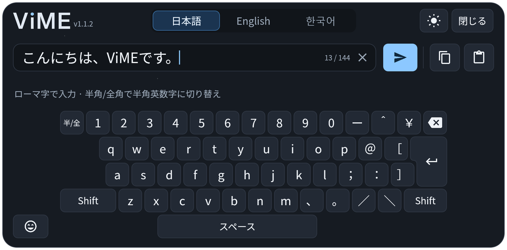
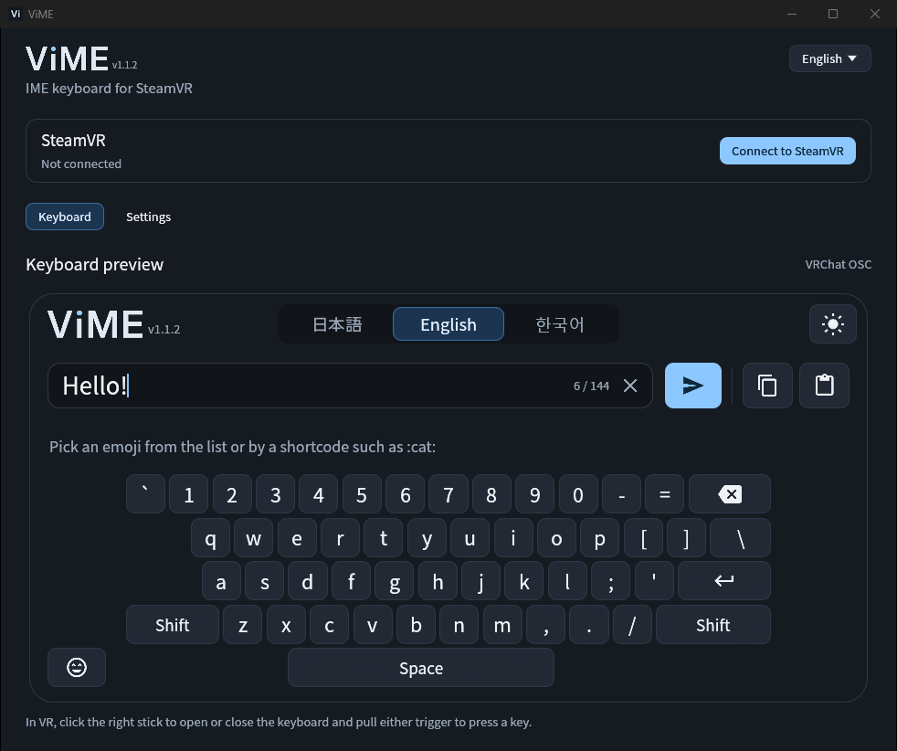
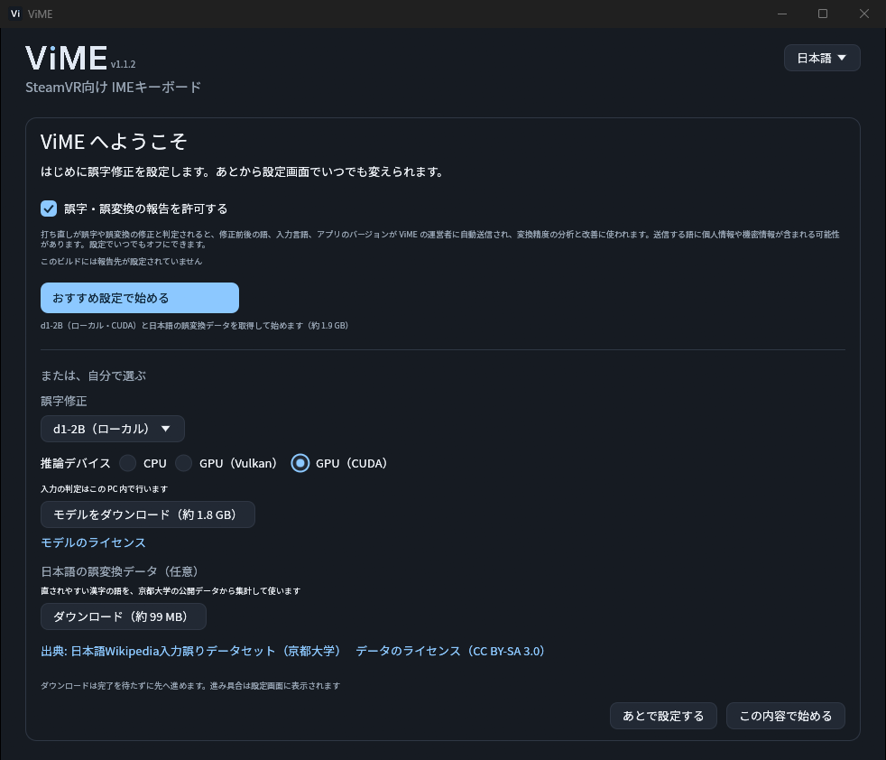
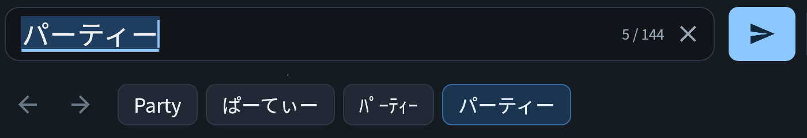
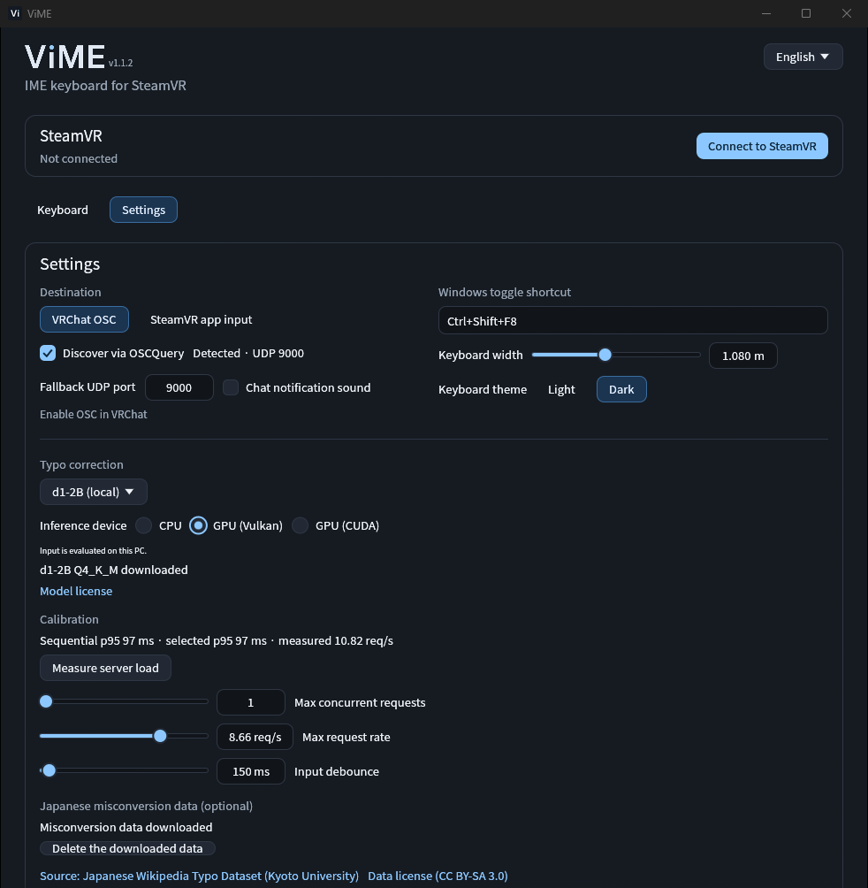

# ViME

ViME is an open-source IME keyboard for SteamVR on Windows. Type in Japanese, English, or Korean with your VR controllers and send text to the VRChat Chatbox or a compatible SteamVR app.

**[Download for Windows (GitHub Releases)](https://github.com/Harukoto-Project/vime/releases)**

[Install](#install) · [Startup and system tray](#steamvr-startup-and-the-windows-system-tray) · [VRChat](#send-a-message-to-vrchat) · [Typing and conversion](#switch-languages-and-convert-text) · [Typo correction](#typo-correction) · [Run from source](#run-from-source)

[English](README.md) · [日本語](README.ja.md) · [한국어](README.ko.md)



<details>
<summary>Windows keyboard preview</summary>



</details>

## Install

1. Download `ViME-<version>-windows-x64.msi` from [Releases](https://github.com/Harukoto-Project/vime/releases).
2. Run the installer, then open **ViME** from the Windows Start menu. The release build runs on Windows x64 and requires no Rust installation.
3. Choose a typo correction setup on first launch. **Start with the recommended setup** downloads local d1-2B, its CUDA runtime, and Japanese misconversion data (about 1.9 GB on a fresh setup). Choose **Set up later** to try the keyboard first.
4. Start SteamVR for VR use. If ViME is already running, select **Connect to SteamVR** in the Windows app. You can try the keyboard in the Windows preview before connecting.



If a release installer is unavailable, [run ViME from source](#run-from-source).

**Upgrading from v1.0.0 or v1.1.0.** When the update is ready in the old app, choose **Settings → Restart to update**. The MSI installer opens and ViME restarts when setup finishes. If you quit ViME from the system tray, the installer opens the next time you launch it. After a successful migration, `ViME.lnk` in the old folder opens the installed app in place of the old `vime.exe`. Your settings and downloaded data carry over.

Release builds check GitHub Releases for updates at startup. Once an update is ready, ViME applies it when you quit via **Exit ViME** in the system tray. Select **Settings → Restart to update** to apply it immediately.

## SteamVR startup and the Windows system tray

1. Run ViME and connect it to SteamVR once to register the overlay.
2. In SteamVR, open **Settings → Startup / Shutdown → Choose Startup Overlay Apps** and turn on **ViME**. When SteamVR starts it, ViME runs in the Windows system tray with its window hidden.

Closing the ViME window also keeps ViME running in the tray, so you can keep using the VR keyboard. Click the tray icon or right-click it and choose **Open window** to reopen the Windows app. To quit, right-click the icon and choose **Exit ViME**. If ViME is already running, starting it again from the Start menu brings the existing window to the front instead of opening a second copy.

## Send a message to VRChat

1. In the VRChat Action Menu, turn on **OSC → Enabled**. Keep ViME’s destination set to **VRChat OSC**.
2. Click the **right thumbstick** (**right trackpad** on Vive Wand) or press **Ctrl+Shift+F8** on your PC to open the keyboard. Point either controller at a key and press the trigger to type.
3. Type a message and press **Enter** or the send button on the VR keyboard to send it to the Chatbox. While converting text, the first **Enter** confirms your text. Press it again to send.

Next to the text field, **×** clears the text, and the copy and paste buttons use the Windows clipboard. Paste is refused if the result would exceed VRChat’s 144-character limit. The sun and moon button in the keyboard header switches between the dark and light themes.

The left and right pointers render independently and update in sync with SteamVR frames, so they can track your controllers between keyboard redraws. The keyboard is drawn at a higher pixel density for sharper text.

**Discover via OSCQuery** finds VRChat’s receiving UDP port on the same PC. It is on by default for new configurations. If you are upgrading with saved v1.0.0 settings, enable it in **Settings** and save. ViME uses the configured UDP port (`9000` by default) while discovery is off or no port is detected. [Official VRChat OSCQuery guide](https://docs.vrchat.com/docs/oscquery)

The **ViME** tab in the SteamVR dashboard gives you access to the keyboard, output settings, and controller bindings.

In the Windows app’s **Settings**, you can change the OSC notification sound, toggle shortcut, VR keyboard width, and keyboard theme (**Dark** or **Light**). The theme applies to the VR keyboard and the Windows app. Settings are stored at `%LOCALAPPDATA%\ViME\settings.json`.

ViME uses Noto Sans JP when it is installed on Windows. Otherwise it falls back to Segoe UI and the Windows Japanese and Korean system fonts.

## Switch languages and convert text

- **Japanese** uses a JIS layout with romaji input. Use the space bar to open conversion candidates for kanji and katakana. Digits and Latin letters stay half-width, while punctuation is full-width by default, including Japanese `、` and `。`. Pick half-width punctuation or katakana from the candidates. The **半/全** key switches to direct half-width input.
- **English** uses QWERTY. **Korean** uses Dubeolsik, with **한/영** to switch to direct Latin input.
- Open the emoji, kaomoji, and symbol palette with **😃** at the bottom left. In English mode, you can also look up emoji with shortcodes such as `:cat:`.
- In unconfirmed Japanese input, **Backspace** removes one displayed character at a time, so `きゃ` becomes `き`. Unfinished romaji stays editable after **Backspace**, so you can correct a mistyped letter and finish the syllable. Spellings such as `kyi`, `swa`, `tsa`, `fwa`, `qa`, and `xn` are supported. Hold **Backspace** or **Space** to repeat the action. Key presses play a click sound.



## Typo correction

With typo correction enabled, ViME can suggest fixes for Japanese readings that are close to dictionary entries. Select a **✓** suggestion to replace the text. The optional Japanese misconversion data adds candidates for kanji conversion errors.

### Choose a device for local d1-2B

**GPU (Vulkan)** can be faster than **GPU (CUDA)** on some PCs. If both are available, measure them under the same conditions.

1. In the Windows app, open **Settings → Typo correction → d1-2B (local)**. Select **GPU (CUDA)** as the inference device and download the model or runtime if prompted.
2. Under **Calibration**, select **Measure server load**. When it finishes, note the **Max request rate** (req/s).
3. Switch to **GPU (Vulkan)**, complete any required downloads, and repeat the measurement under the same conditions. Choose the option with the higher **Max request rate** and select **Save settings**. Select **CPU** if GPU inference is unavailable.

If you previously set the rate manually, select **Use measured limits** for each device before comparing the values.

Read the **Max request rate** field below the **Measure server load** button. The **measured** req/s value above the button is the throughput observed during the test.



### APIs and reporting

Local d1-2B runs on your PC. When you select **d1-2B (API)**, **TypeSafe Jev**, or a **System One-compatible** service, ViME sends the word being checked and some surrounding text to the configured endpoint.

**Allow typo and misconversion reports** is on by default. If the build has a reporting endpoint and typo correction is enabled, ViME sends the original and corrected words, input language, and ViME version to the maintainers when it identifies a retyped word as a correction. You can turn reporting off during first-run setup or in **Settings**. [Reporting API details](CONTRIBUTING.md#誤字誤変換の報告-api)

## Use ViME with another SteamVR app

In ViME’s **Settings**, choose **SteamVR app input** as the destination and save. Open a text field in the target app, bring that app to the foreground in Windows, and press **Enter** on the VR keyboard. The target app must accept Windows text input events.

## Troubleshooting

- **The controller shortcut does not open the keyboard.** Try **Ctrl+Shift+F8** first. Open the SteamVR binding editor from ViME to change the controller shortcut or restore the default binding.
- **Messages do not appear in the Chatbox.** Check that OSC is enabled in VRChat and the destination is **VRChat OSC**. If Settings shows no detected port, check that the configured UDP port matches VRChat’s receiving port.
- **ViME cannot find SteamVR.** Start SteamVR and reconnect. For a custom installation, set the `STEAMVR_PATH` environment variable to the SteamVR installation directory.

ViME is a prototype. Headset rendering, per-controller bindings, and VRChat reception still need testing on actual hardware. Include your ViME version, hardware models, and steps to reproduce when reporting a problem. [GitHub Issues](https://github.com/Harukoto-Project/vime/issues)

## Run from source

You need Windows x64, Rust 1.95 or later, and MSVC C++ Build Tools. Run this from the repository root.

```powershell
cargo run --release --locked
```

The executable is built at `target/release/vime.exe`. See the [contribution guide](CONTRIBUTING.md) for development and pull requests.

## License

[Apache License 2.0](LICENSE)

### Data downloaded on request

ViME contains no copy of the Japanese Wikipedia Typo Dataset. If you press **Download** under *Japanese misconversion data* in the settings, ViME fetches [JWTD v2](https://nlp.ist.i.kyoto-u.ac.jp/EN/index.php?JWTD) (Kyoto University Language Media Processing Lab, [CC BY-SA 3.0](https://creativecommons.org/licenses/by-sa/3.0/)) directly from Kyoto University and counts which kanji words editors corrected. Only that table of words is kept, in `%LOCALAPPDATA%\ViME\misconversions.tsv`; it is not shared and stays under CC BY-SA 3.0. Tanaka, Murawaki, Kawahara, and Kurohashi, NLP 2021. [JWTD v2 paper](https://www.anlp.jp/proceedings/annual_meeting/2021/pdf_dir/E8-3.pdf)

Key sounds come from unicaegames’ [Keyboard Soundpack #1](https://opengameart.org/node/122745) ([CC0 1.0](https://creativecommons.org/publicdomain/zero/1.0/)). Keyboard icons are from Google’s [Material Icons](https://mui.com/material-ui/material-icons/) by way of MUI ([Apache License 2.0](LICENSE)). Local inference uses [llama.cpp](https://github.com/ggml-org/llama.cpp) and [Liquid AI’s d1-2B Q4_K_M](https://huggingface.co/LiquidAI/d1-2B-GGUF).
